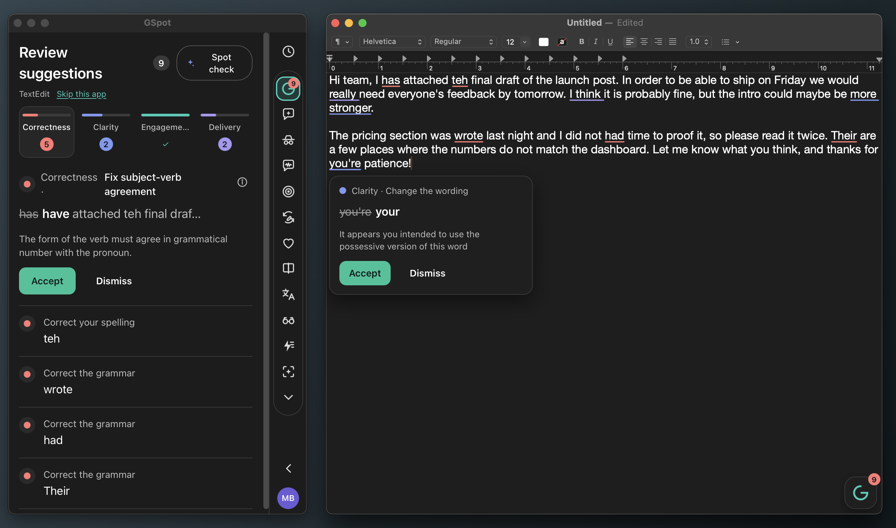

# GSpot



A local-first, open-source Grammarly-style writing assistant for macOS and Windows. A floating panel docked to the
left edge of the screen follows the text field you are typing in (any app), underlines issues in place,
and runs the full sidebar of tools: suggestions, AI chat, plagiarism, tone, performance score,
paraphraser, humanizer, reader reactions, translate, explain it, AI rewriter, AI detector.

The panel starts **tucked**: a small G tab sits flush with the left screen edge. Click the tab and the
panel slides out; the red close button or the "Tuck away" chevron at the bottom of the rail slides it
back. The tab shows the current suggestion count. (Grammarly tucks into the right edge; GSpot
tucks into the left. `dock_side` in Settings flips it.)

* Correctness engine: [Harper](https://writewithharper.com) (`harper-core`, in-process, offline).
  A sentence over 40 words gets a "Split the long sentence" card with a lossless split ready to accept;
  the spot check (the model) replaces it with a better split when one passes the guards.
* Text access: the macOS Accessibility API (focused field, selection, `AXBoundsForRange` geometry),
  and on Windows UI Automation (`src-tauri/src/uia.rs`: the focused Edit/Document element, its
  TextPattern text, selection and `GetBoundingRectangles` geometry). `src-tauri/src/platform.rs` is
  the one interface the host loop uses on both.
  Terminals (Terminal, iTerm2, Warp, Ghostty, kitty, Alacritty, WezTerm, Hyper; Windows Terminal,
  cmd, PowerShell, ConEmu, mintty and others) are skipped: a shell transcript is not writing. Any
  other app can be skipped from the Review view ("Skip this app") and turned back on under
  Settings → Skipped apps.
* Replacements: AX selected-text set, then a verified pasteboard patch fallback. On Windows: the
  edit control's own select-and-replace messages (Notepad, WordPad, other Win32 edit and rich-edit
  fields), then a UI Automation selection plus a verified Ctrl+V paste (browsers, Office), then the
  field's UI Automation value for plain fields.
* Sign in with publik: GSpot opens with a sign-in window. A signed-in person then picks publik API
  ("Get a plan" or "Connect your plan") or their own key ("Use my own key"). The answer is kept, and
  Settings → AI changes it later.
* AI features: **publik API** (this computer's publik key, minted at sign-in; a plan or a balance on
  your publik account pays per use at a published price),
  or your own key (paste it; OpenAI, Anthropic, OpenRouter, Groq and Google are detected from the
  prefix and a model is picked for you). URLs, ports and model names sit under "Advanced". There
  is no local-model option; only the e2e rig points the app at Ollama, through the debug probe.
* Spot check: sentence-level suggestions (make it concise, active voice, rephrase for clarity,
  remove a repeated or filler sentence) from the model, guarded so numbers, names and quotes
  survive and clean prose is left alone. See `docs/SPOTCHECK.md`.
* Plagiarism: web search through publik API when it is on (`POST /search`, one cent a search), your
  own Brave Search API key if you paste one in Settings, else a keyless chain (Brave HTML, Bing,
  DuckDuckGo); 7-gram overlap, APA/MLA/Chicago citations.

See `docs/REVERSE-ENGINEERING.md` for what was learned from Grammarly Desktop and `docs/PLAN.md` for the gates.

## Install

GSpot is listed on [publik](https://publikhq.com/gspot).

**macOS** (Apple silicon):

1. Download `GSpot_<version>_aarch64.dmg` from the [latest GitHub release](https://github.com/Blueturboguy07/gspot/releases/latest).
2. Open the dmg and drag GSpot to Applications.
3. Open GSpot. The app is signed with a Developer ID and notarized by Apple, so macOS opens it without a warning.
4. Grant Accessibility when asked, under System Settings, Privacy & Security, Accessibility.

**Windows** (10 and 11, x64):

1. Download `GSpot_<version>_x64-setup.exe` from the [latest GitHub release](https://github.com/Blueturboguy07/gspot/releases/latest).
2. Run it. The installer is not code-signed yet, so SmartScreen may say "Windows protected your PC":
   click **More info**, then **Run anyway**. It installs for your account only (no admin prompt) into
   `%LOCALAPPDATA%\GSpot`, with a Start menu shortcut.
3. Open GSpot. Windows needs no permission for it to read the text field you type in.
   (It cannot read apps that run as administrator unless GSpot does too.)

GSpot lives in the menu bar (macOS) or the notification area (Windows), and as a tab on the left
screen edge. The first start shows "Sign in with publik". After sign-in you choose publik API or
your own key.

## Usage counts

GSpot sends two usage events to publik: `app_opened` at start, and `active_session` every 30 minutes
while it runs. An event holds the app name, the app version, the operating system, the CPU type and a
random install ID and this computer's publik key (from the sign-in), so a signed-in person is counted
once. No text, no file name and no personal data is sent. To turn it off, set `DO_NOT_TRACK=1` in the environment, or put
`{"usage": false}` in `~/Library/Application Support/publik/consent.json` (Windows:
`%LOCALAPPDATA%\publik\consent.json`).
Details: https://publikhq.com/skills/telemetry.md

## Build

```bash
pnpm install        # installs ui/ as well (postinstall)
pnpm dev            # hot reload: Vite + the app
# signed release (.app + .dmg)
scripts/build-debug.sh                   # debug build with the publik app token compiled in (for the e2e gates)
scripts/build-macos.sh --skip-notarize   # or with NOTARY_PROFILE / APPLE_ID+APPLE_PASSWORD+APPLE_TEAM_ID
scripts/verify-macos.sh                  # codesign, Gatekeeper, launch
```

Windows: `.github/workflows/windows.yml` builds `GSpot_<version>_x64-setup.exe` (NSIS, per-user,
`tauri build --bundles nsis`) on a Windows runner with the `PUBLIK_APP_TOKEN` secret, runs the unit
tests there, and then runs `tests/e2e/windows/e2e.ps1` on clean Windows Server 2022 and 2025 runners
(see Test).

Grant Accessibility to GSpot once (System Settings → Privacy & Security → Accessibility).
The publik app token is read from `PUBLIK_APP_TOKEN` or `~/.publik/gspot-app-token` at build
time (minted with publik's `scripts/mint-app-token.mts gspot`); a build without it cannot sign in
a new computer, and the sign-in window says so. `PUBLIK_SELF_TEST=1 /Applications/GSpot.app/Contents/MacOS/grammarlama`
prints one line that proves the publik API wiring of a built app.

## Test

```bash
cd ui && pnpm test                         # TypeScript unit tests
cd src-tauri && cargo test                 # Rust unit tests (engine, score, phrases, plagiarism, …)
tests/e2e/host_textedit.sh                 # reads/lints/fixes a real TextEdit document through AX (incl. a spot-check accept)
tests/e2e/features.sh                      # every LLM/web feature against the rig's Ollama + the live web
tests/e2e/spotcheck.sh                     # the 14-document spot-check corpus through the app (>= 90 % to pass)
tests/tuning/live_corpus.sh                # the same corpus through the pipeline alone (no app windows)
tests/e2e/setup.sh                         # publik API provisioning, own-key probe, the rig's Ollama
```

Windows: `tests/e2e/windows/e2e.ps1 -Installer GSpot_<version>_x64-setup.exe` installs the app
silently, starts it with the debug probe, and drives Notepad (Win32 edit control), WordPad (rich
edit) where the OS still has it, and a Microsoft Edge text area: text read, underline position checked
against the editor's own UI Automation rectangle, hover card, a real click on the card's Accept,
Accept through the probe, the no-model spot check, the panel, the terminal skip, and uninstall. It
saves a screenshot at each step and, with ffmpeg on the PATH, a desktop recording. It types and
clicks, so it runs only on a disposable runner (the `windows` workflow).

The e2e scripts launch the debug binary with `GRAMMARLAMA_DEBUG_PORT=47331` and talk to a loopback
probe (`/state`, `/accept`, `/feature`, `/lint`). `start_app` then points the app at the rig's Ollama
(`qwen2.5:7b`, or `E2E_MODEL`) through the probe, because the product itself offers no local model;
`E2E_KEEP_LLM=1` runs the gates on whatever the app is set to. A debug (`cargo build`) binary loads the Vite dev
server, which the harness starts for you. To test the signed bundle instead:

```bash
APP_BIN=src-tauri/target/release/bundle/macos/GSpot.app/Contents/MacOS/grammarlama tests/e2e/host_textedit.sh
```

Accessibility trust: a binary launched from a terminal inherits the terminal's grant (macOS charges
the "responsible process"). Launched from Finder, GSpot asks for its own grant once.
